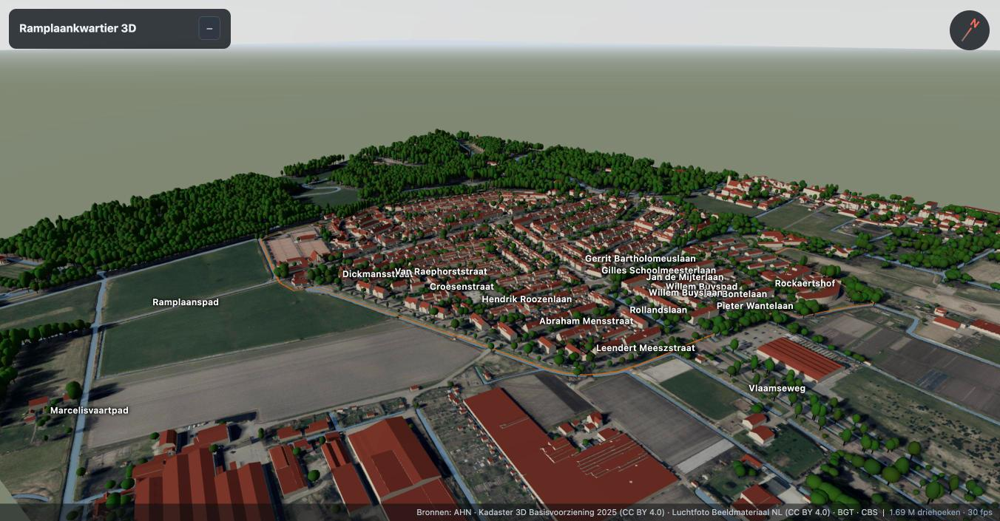

# Ramplaankwartier 3D

Interactief 3D-model van het Ramplaankwartier (Haarlem) met grove omgeving tot 10 × 10 km, opgebouwd uit open overheidsdata
(AHN, Kadaster 3D Basisvoorziening, luchtfoto's, BGT, CBS). Het model draait in de browser op een gewone
computer, met vrij gezichtspunt, zonnestand met schaduwen, wandelmodus en BAG-informatie per pand.



## Online

De viewer staat op <https://deltagroen.nl/ramplaankwartier/>. Deployen gaat via de website-repo
`deltagroen/Sites`: de workflow "Deploy production" daar checkt deze repo uit en kopieert `viewer/` naar
`docs/ramplaankwartier/`, waarna de site als release naar de VPS gaat. Na een modelwijziging dus:

```bash
git push                                                   # deze repo
gh workflow run deploy-production.yml -R deltagroen/Sites  # site opnieuw deployen
```

## Viewer starten

De viewer moet via een lokale webserver worden geopend (browsers blokkeren het laden van modelbestanden
vanaf `file://`).

- macOS: dubbelklik op `start.command` (of in Terminal: `./start.command`).
- Windows: dubbelklik op `start.bat`.
- Handmatig: `cd viewer && python3 -m http.server 8765` en open <http://localhost:8765/>.

De map `viewer/` is zelfstandig: kopieer die map naar een andere computer of zet hem op een webserver
(bijv. GitHub Pages) en hij werkt zonder verdere installatie. Omvang circa 70 MB, waarvan 38 MB omgeving die in vijf delen na het hoofdmodel wordt geladen (ring eerst, buitenzone laatst).

Bij het openen wordt de dag afgespeeld: de camera begint recht boven de wijk vlak voor zonsopkomst, kantelt naar
de opkomende zon, vliegt een lus om en door de wijk op wisselende hoogtes terwijl de zon zijn baan aflegt, en
eindigt vanaf de oostkant kijkend naar de ondergaande zon (circa 110 seconden, datum uit het datumveld). De lus
wordt elke keer willekeurig gegenereerd; begin- en eindpunt liggen vast. De baan blijft minstens 12 m boven het
hoogste object binnen 6 m (gebouwen, bomen, masten, uit een 4 m-oppervlaktegrid van het DSM), met één korte lage pas
op 12 m door een rechte straat of over een brede watergang zonder obstakels binnen 3,5 m (`model/streets.json`,
berekend in `build_misc.py`). De lus volgt de CBS-buurtgrens: de vluchtpunten liggen op 55–100% van de afstand van het
middelpunt tot de grens (hooguit 30 m erbuiten), begin- en eindpunt 40–110 m erbuiten, en de aanloop van de lage pas
hooguit 60 m erbuiten; alleen corridors met beide einden binnen 40 m (water 150 m) van de grens komen in aanmerking. De camera kijkt vooruit, naar een punt 200 m verderop op de baan, zodat het hoofd
meedraait in de richting waarin daarna gevlogen wordt (hoogstens 35 graden per seconde); de snelheid is constant,
met vertraging in scherpe bochten en in de lage pas. Tijdens het vliegen zijn het paneel ingeklapt en de
straatnamen uit. Elke muis- of toetsactie stopt het afspelen; de knop "Dag afspelen" of de spatiebalk start het
opnieuw.

De bomen volgen het seizoen van de gekozen datum, per soort: uitlopen in april (fris lichtgroen, wilg en els
vroeg, eik en es laat), bloesem bij sierappel, meidoorn, sierkers, sierpeer, magnolia en kastanje op het moment
van die soort, zomergroen per soort (bruine beuk donkerrood, abelen grijsgroen), verkleuring vanaf eind
september naar de kleur van de soort (beuk koper, berk en linde geel, Parrotia rood, amberboom purper, els en
wilg dof), bladval, en in de winter kale bomen: de kroon verdwijnt en een takkensilhouet verschijnt (drie
verticale en een horizontaal vlak met een procedureel getekende takkentextuur, zie `makeTwigTexture()`). De
stamdikte komt uit de stamomtrek in het register (anders geschat uit de hoogte) en het silhouet wordt gekozen uit
vier varianten zodat de getekende stam op de stamcilinder aansluit; de takken vertakken volgens het pijpmodel.
Groenblijvende soorten (den, leylandcipres, hulst, taxus) houden hun kroon. Tabel in `pipeline/species.py`,
toewijzing en kroonvorm (rond, breed, zuil, treur, kegel) in `build_trees.py`, kleuring in `applySeason()`.

Botsingen: de viewer gebruikt een obstakelgrid van 2 m (`model/block_2m.u16`, gemaakt in `build_misc.py`) met per
cel de boven- en onderkant van gebouwen en boomkronen en een watervlag. Bij het rondkijken kan de camera niet door
gevels, daken of kronen en niet onder het maaiveld; bij het lopen houden gevels, boomstammen en water je tegen,
maar onder een kroon kun je door, en op water kun je alleen als het ijs dik genoeg is. Lopen gaat 6 m/s, met
Shift 12 m/s.

De omgeving is alleen decor: het kijkpunt blijft binnen het werkgebied, de camera hooguit 150 m daarbuiten en
niet hoger dan 1200 m. Ze bestaat uit een ring van 6 × 6 km (gebouwen met dakvormen, bomen met seizoenen, water)
en een buitenzone van 10 × 10 km (blokgebouwen en water, met de Noordzee op −0,4 m NAP).

Bediening: slepen = verschuiven, draaien = rechter muisknop, Ctrl/Shift+slepen, twee vingers op een trackpad,
toetsen `Q`/`E` of de draaiknoppen in het paneel (`R`/`F` kantelen, knop of kompas = noorden boven),
scrollen = zoomen, pijltjes = verschuiven, klik op een pand = BAG-gegevens, `W` = wandelen (WASD/pijltjes,
Shift = rennen, Esc = stoppen), `O` = overzicht. In het paneel: lagen aan/uit, datum en tijd voor de zonnestand, panden kleuren op
bouwjaar, BGT-maquette in plaats van luchtfoto.

## Wat zit erin

| Laag | Bron | Opmerking |
|---|---|---|
| Terrein | AHN DTM 0,5 m via PDOK WCS (actuele AHN; hier AHN5, gevlogen 2023) | 1 m-grid, vereenvoudigd tot ca. 0,8 M driehoeken, gaten gevuld, water ingebrand; brugdekken en wegvlakken boven water uit de Kadaster-3D-vlakken als getextureerde driehoeken op hun echte hoogte |
| Luchtfoto | Luchtfoto Beeldmateriaal NL 2026, 8 cm (PDOK WMS, laag `2026_orthoHR`) | 16 texturen van 2048², ingebed in terrain.glb |
| Gebouwen | Kadaster 3D Basisvoorziening 2025, LoD 2.2 (CityJSON) | 2730 panden, met bouwjaar en BAG-id; dakkleur = mediaankleur van de luchtfoto binnen het dak; gevelkleur = schatting op bouwjaar, afmeting en dakkleur (zie hieronder); 1,5 m onder maaiveld doorgetrokken |
| Bomen | Boomregister gemeente Haarlem (soort, leeftijd, kroonklasse) gekoppeld aan BGT-boompunten, plus automatische detectie in DSM-DTM | 1011 bomen met soort, 352 BGT-punten zonder soort, 6465 gedetecteerde tuinbomen (indicatief); hoogte uit AHN; klik op een boom voor soort en leeftijd |
| Water, wegen, groen | Kadaster 3D Basisvoorziening 2025 (BGT-vlakken met hoogte) | water altijd zichtbaar; wegen/groen als "maquette"-laag |
| Buurtgrens, straatnamen | CBS Wijken en Buurten 2025, BGT openbareruimtelabels | |
| Omgeving, ring | AHN DTM/DSM 5 m, luchtfoto 1,5 m/px, Kadaster LoD 2.2, BGT-waterdelen en -boompunten, boomregister Haarlem | 6 × 6 km rond de wijk, grof en niet bevliegbaar: terrein op 10 m met gat voor het werkgebied, 61 duizend panden met dakvorm inclusief schuurtjes (dakkleur uit de foto, gevels neutraal, vlakke schaduw), water op oeverhoogte, 51 duizend bomen (44 duizend BGT-punten, waarvan 37 duizend met soort uit het register, 6,5 duizend gedetecteerd in DSM−DTM) als eenvoudige kronen zonder takken, en dichte bossen (5,5 km², vooral de duinen) als kroonlaag op de DSM-hoogte; panden en bomen binnen 400–600 m van de wijk werpen schaduw; `build_context.py` |
| Omgeving, buitenzone | AHN DTM 10 m, luchtfoto 2,5 m/px, Kadaster LoD 1.2 (blokken), BGT-waterdelen | 10 × 10 km met gat voor de ring: terrein op 20 m, 53 duizend blokgebouwen, 5 duizend watervlakken; grote gaten in het AHN (zee, Mooie Nel) op −0,4 m NAP; `build_context.py buiten` |

Coördinaten: RD New (EPSG:28992) met NAP-hoogtes, verschoven naar lokaal nulpunt RD (101800, 488600).
In het model is x = oost, y = omhoog, z = zuid (glTF-conventie). Werkgebied RD 101100–102500 / 488000–489200.

## Opnieuw bouwen

Vereisten (eenmalig):

```bash
brew install micromamba            # of zie https://mamba.readthedocs.io
micromamba create -y -n ramplaan3d -c conda-forge python=3.12 numpy scipy rasterio shapely pyproj \
    geopandas gdal pdal python-pdal mapbox_earcut pillow requests laspy lazrs-python
# Node.js (voor gltf-transform via npx), bijv. brew install node
```

Daarna:

```bash
./run_pipeline.sh
```

De stappen staan los in `pipeline/` en kunnen ook apart worden gedraaid (`fetch_data.py` gebruikt alleen de
standaardbibliotheek; de overige scripts draaien in de micromamba-omgeving). Instellingen zoals het werkgebied,
de textuurresolutie en de luchtfotolaag staan in `pipeline/config.py`. Brondata komt in `data/raw/` (wordt
overgeslagen als het al bestaat), tussenresultaten in `data/work/`, het model in `viewer/model/`.

Pipeline:

1. `fetch_data.py` – DTM/DSM (WCS), luchtfototegels (WMS), Kadaster CityJSON-tegels, BGT-bomen en -labels, boomregister Haarlem (GeoServer data.haarlem.nl, laag bor_bomen), CBS-buurtgrens.
2. `build_water_maquette.py` – water.glb en maquette.glb; schrijft ook de watervlakken voor stap 4 en 6.
3. `build_buildings.py` – buildings.glb en buildings.json (attributen per pand).
4. `build_terrain.py` – terrain.glb (16 patches met UV's) en heights_2m.u16 (hoogtegrid voor de viewer).
5. `build_textures.py` – WebP-texturen per patch.
6. `build_trees.py` – trees.glb (kronen, stammen en takkensilhouetten), trees.json en species.json.
7. `build_misc.py` – buurtgrens.json, labels.json, scene.json.
8. `build_context.py` – omgeving in stappen `ring`, `bomen`, `buiten` (standaard alle drie): context_terrain.glb,
   context_objects.glb, context_trees.glb (ring 6 × 6 km) en context_outer_terrain.glb, context_outer_objects.glb
   (buitenzone 10 × 10 km). Draai `bomen` na `build_trees.py`, omdat species.json wordt aangevuld.
9. `optimize.sh` – terrein vereenvoudigen en meshopt-compressie (gltf-transform). `buildings.glb` blijft
   ongecomprimeerd omdat het `_BID`-attribuut exact moet blijven.

## Weer

Standaard toont de viewer het werkelijke weer van de gekozen dag, per uur, uit [Open-Meteo](https://open-meteo.com)
(lage, middelbare en hoge bewolking, neerslag, zicht; tot 90 dagen terug en 15 dagen vooruit via de verwachting,
ouder via het archief). Zonder internet of buiten dat bereik geldt een klimatologische schatting die per dag vast
is. Het wolkendek is één procedureel ruisveld op 1500 m hoogte dat met de tijd drijft. Zichtbaar is het als koepel
om de camera die per kijkrichting de snijding met dat vlak bemonstert, zodat het dek tot aan de horizon doorloopt
en bij een gesloten dek de zon de hele dag onzichtbaar is; een hoge sluier zonder laag dek laat een melkwitte zon
door. Hetzelfde ruisveld wordt als plat vlak in de schaduwkaart van de zon getekend (eigen dieptemateriaal), dus
de wolkenschaduwen op de grond zijn de parallelle projectie van dezelfde wolken langs de zonrichting. Verder stuurt
het weer de sterkte van het zonlicht, de nevel (zicht) en regenstrepen. Temperatuur, sneeuwval en sneeuwhoogte
komen ook uit Open-Meteo: neerslag onder de 1,5 graad valt als vlokken, en de sneeuwhoogte van het weermodel
(die blijven liggen en smelten al meeneemt) wordt een wit dek op alles wat naar boven kijkt, via een kleine
toevoeging aan de standaardshader (`enableSnow()`), dus op daken, wegen, velden en kronen maar niet op gevels.
IJs volgt uit de vorstsom van de voorgaande twaalf dagen (daggemiddelden onder nul opgeteld, dooi telt anderhalf
keer tegen): vanaf 8 graaddagen dun ijs, bij 25 een dichte laag; bevroren water wordt mat, licht grijsblauw en
ondoorzichtig, met sneeuw erop als die er ligt. In het paneel kan het weer worden vastgezet: helder, halfbewolkt,
sluierbewolking, bewolkt, regen, mist of sneeuw en ijs. Probeer bijvoorbeeld 10 februari 2021.

## Gevelkleuren

Voor gevels bestaat geen open bron: de stereo- en obliekopnamen van Beeldmateriaal zijn niet open, de open
puntenwolk daaruit is een 8 cm-raster met nadirkleur zonder gevelpunten, en open straatbeelden (Mapillary,
Panoramax) dekken maar een deel van de straten. Daarom schat `pipeline/facade_colours.py` per pand een gangbaar
gevelmateriaal op basis van bouwperiode, met samenhang per bouwrij (zelfde bouwjaar binnen 30 m krijgt hetzelfde
materiaal), bijgebouwen in donker hout of grijs, grote lage hallen in grijs of kasglas. De keuze staat per pand in
`buildings.json` (`gevel_mat`, `gevel_bron`) en in het infopaneel van de viewer.

Handmatig corrigeren kan met `overrides/gevelkleuren_override.json`, bijvoorbeeld:

```json
{ "0392100000025541": "pleister_wit", "0392100000023311": [0.62, 0.40, 0.30] }
```

Sleutel is het BAG-pand-id (zie het infopaneel), waarde een materiaalnaam uit het palet in `facade_colours.py`
of een eigen kleur. Daarna `build_buildings.py` opnieuw draaien.

## Bekende beperkingen

- Jaargangen verschillen: AHN5 is van 2023, gebouwen en luchtfoto van 2025/2026. Panden gebouwd na 2023
  kunnen ontbreken of als blok (LoD 1.3) verschijnen.
- Automatisch gedetecteerde bomen zijn een benadering uit het hoogtemodel (winteropname): aantal, hoogte en
  kroonmaat zijn indicatief; dichte bosranden worden als rijen bollen weergegeven.
- Het terrein is het maaiveld; bruggen en viaducten zijn als BGT-vlak aanwezig maar niet als volume.
- De omgeving is grof: bomen zonder takkenmodel (kale kronen worden doorzichtig bruin), bossen als kroonlaag,
  soorten alleen binnen Haarlem (elders BGT-punten zonder soort en detectie in het hoogtemodel), gevels in één
  neutrale kleur. De hele scène is circa 6,6 M driehoeken; op een oudere laptop kan de laag Omgeving uit.
- Gevelkleuren zijn een schatting per bouwperiode, geen meting; de dakkleur komt wel uit de luchtfoto
  (winteropname, dus incl. mos en zonnepanelen, licht opgehaald in verzadiging).

## Bronnen en licenties

AHN (CC0/CC BY 4.0, ahn.nl), Kadaster 3D Basisvoorziening (CC BY 4.0), Luchtfoto Beeldmateriaal Nederland
(CC BY 4.0), BGT (CC0), CBS Wijken en Buurten (CC BY 4.0), boomregister gemeente Haarlem (open data, CC BY-SA 4.0). Vermeld bij publicatie de bronnen zoals onder
"Bronnen en licenties" onderaan het paneel van de viewer. Software: three.js (MIT), SunCalc (BSD-2), gltf-transform (MIT), meshoptimizer (MIT).
